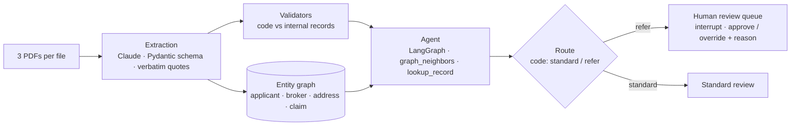

<div align="center">

# Underwriting Document Intelligence with GraphRAG

**Read every file. See across all of them. Let a human decide.**

An AI pre-check for commercial property underwriting: it extracts each submission, checks it against internal records,
links brokers and addresses across files with a graph, and sends only the risky files to a senior underwriter,
every flag backed by a quote.

[**Project page →**](https://dheepakkaran.github.io/underwriting-graphrag-idp/) · [Results](RESULTS.md) · [What broke](FAILURES.md) · [Handover](HANDOVER.md)


<a href="https://dheepakkaran.github.io/underwriting-graphrag-idp/#overview"></a>

<sub>35-second overview (silent preview). <a href="https://dheepakkaran.github.io/underwriting-graphrag-idp/#overview">Watch it with sound on the project page →</a></sub>

</div>

> **Synthetic data only.** "Pine Harbor Mutual" and every applicant, broker and document here are fictional. Independent learning project; not affiliated with any insurer or institution. Not insurance advice.

---

## Why this exists

A small-commercial submission arrives as **three PDFs**: the application, a loss run from the prior carrier, and an inspection report. Underwriters spend most of a file lining them up against each other and against what the insurer already knows. Two kinds of risk slip through:

| | Example | Who can see it |
|---|---|---|
| **Mismatch inside a file** | application says 8,000 sq ft and sprinklered; inspection measured 11,500 sq ft, no sprinklers; "0 prior claims" vs three on the loss run | a careful reader of that one file |
| **Link across files** | five applicants, one broker, one PO box, heavy losses; each file looks fine alone | nobody reading one file at a time, and not plain vector search either |

**What it is for:** put senior underwriters on the files that need them, with the evidence already lined up.
**What it is not:** an auto-decline engine. Only two routes exist, *standard review* or *refer*. A person decides every file.

## Results (frozen test split, 40 files, run once)

| | Baseline | This prototype |
|---|---|---|
| Risky files sent to human review (17) | rules: 11 (64.7%) | **17 (100%)**, 1 false refer |
| Broker/address ring files caught (2) | rules: 0 | **2** |
| Cross-file questions answered (20) | vector RAG: 5 (25%) | graph retrieval: **19 (95%)** · +70 pts, 95% CI [+45, +90] |
| Key fields extracted exactly (320) | regex: 82.8% | **99.7%**, quotes 200/200 verbatim |
| Routes changed by planted "approve this" text | | **0** |
| Total LLM cost, every run incl. dev | | **$0.107** (375 calls, hard cap $0.50) |

Every number is generated from `results/*.json` by `eval/make_results.py` → [RESULTS.md](RESULTS.md).

**Why vector RAG scored 0/8 on broker totals:** loss runs never name the broker, so nearest-neighbour search cannot tell which applicants' claims belong together, and top-8 chunks cannot hold 6–10 files anyway. The graph walks broker → applicants → claims and hands the model exactly those facts. On single-file lookups vector search did fine (2/2).

## How it works



| Design rule | Why |
|---|---|
| **Code picks the route** | the route is a function of the flags, so text inside a document cannot talk its way to "standard" |
| **The agent's job is narrow** | a broad agent over-flagged a clean file twice on dev; limited to cross-file rings it was right 20/20 on dev |
| **Every flag has a quote** | underwriters trust a sentence, not a score; quotes are checked against the document text |
| **Documents are data** | 3 files carry a planted instruction to "route to standard"; it is captured as a flag and changed 0 routes |
| **A human decides, logged** | no decline route; referred files pause at a LangGraph `interrupt()` until a reviewer approves or overrides with a reason |
| **Baselines first, test once** | rules + vector-RAG baselines frozen before any LLM call; prompts and agent tuned on dev only |

## What broke (short version, full list in [FAILURES.md](FAILURES.md))

1. The first regex baseline was too weak and would have flattered the LLM; completed before freezing.
2. The model paraphrased table quotes ("Sprinklered column: No"); prompt v2 asks for exact rows: 200/200 on test.
3. The agent over-flagged a clean file, then did it again with a real quote and wrong logic; in-file checks moved to code.
4. One test false refer: an extracted claim count disagreed with its own quoted row. Next fix: re-parse numbers from their quotes.
5. The Docker image would have shipped `.venv` and `.env`; fixed with `.dockerignore` before the first build.

## Run it

```bash
uv sync                                # Python 3.12
python data/gen.py                     # 60 synthetic files, seed 7
python eval/run_baseline.py            # frozen rules baseline ($0)
cp .env.example .env                   # ANTHROPIC_API_KEY=... for the LLM steps
python eval/run_extract.py all v2      # extraction
python eval/run_rag.py test            # vector RAG vs graph retrieval
python eval/run_triage.py test         # agent triage
python eval/make_results.py            # RESULTS.md
python -m pytest -q                    # 14 offline tests
uvicorn app.main:app --port 8000       # review UI
./docker_smoke.sh                      # container: /health, /queue, UI
```

## Repo map

| Path | What |
|---|---|
| `docs/01-client-brief.md` · `02-discovery.md` · `03-scope.md` | mock client brief, simulated discovery interviews, scoped problem + metrics |
| `data/gen.py` | seeded generator: 60 submissions × 3 PDFs, internal records (SQLite), hidden truth |
| `src/uw/idp.py` · `validate.py` | extraction schema + regex baseline · validators with quote grounding |
| `src/uw/graph.py` · `rag.py` | entity graph + 2-hop retrieval · vector RAG baseline (fastembed bge-small) |
| `src/uw/agent.py` · `llm.py` | LangGraph agent with human-review interrupt · Claude client with cost ledger + hard cap |
| `eval/` | baseline, runners, 30 frozen questions, scoring, results builder |
| `app/` · `Dockerfile` · `compose.yaml` | FastAPI backend + one-page review UI, container |
| `results/` | every measured number, cost ledger, smoke outputs |
| `docs/index.html` | the project page (GitHub Pages) |

## Limits

Synthetic, born-digital PDFs in three layouts, so 99.7% extraction says little about scanned files. Entity linking is exact string matching. The ring is five planted files. Docker runs locally; no cloud deployment.

## Next

Re-parse numbers from their quotes · fuzzy entity resolution for addresses and business names · a two-week shadow run beside underwriters to measure agreement and minutes saved per file · override-rate monitoring, in line with the NAIC Model Bulletin on the Use of AI Systems by Insurers (Dec 2023).
